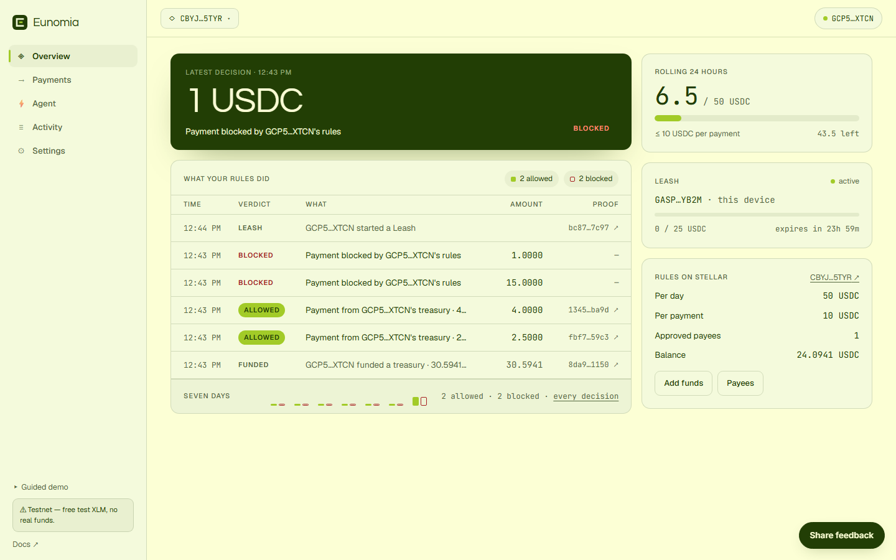

<div align="center">


# Eunomia

### The wallet your AI agent can't drain.

A non-custodial Soroban treasury that lets a business hand an autonomous AI agent **real money to spend** — where the **contract**, not the model's good behaviour, enforces the limits. The owner funds it from their own wallet, connects any MCP agent with one command, and every payment is checked, attributed and settled on Stellar in sub-cents.

<sub>**Formerly PRISM** — renamed to Eunomia ahead of mainnet. Hackathon results, tester evidence and on-chain history in this repo refer to the same product.</sub>

[](https://github.com/eunomia-finance/eunomia/actions/workflows/ci.yml)
[](https://www.npmjs.com/package/eunomia-mcp)


**[▶ Live app](https://eunomia.finance) · [📖 Docs](https://eunomia.finance/docs/) · [🎥 Demo video](https://youtu.be/W9pUksD5i3I) · [🔌 Connect your agent](packages/mcp/README.md) · [🗺 Roadmap](ROADMAP.md) · [📄 Deployment & proofs](DEPLOYMENT.md)**

<br/>



<sub>Not a mock-up: one treasury, paid from twice and refused twice — over the per-payment cap, then to an address nobody approved.</sub>

</div>

---

> **Mainnet beta.** Eunomia runs on Stellar mainnet with real funds. During the beta every treasury carries a deposit cap fixed at creation; the contracts' addresses are in [`DEPLOYMENT.md`](DEPLOYMENT.md).

## The problem

AI agents can reason, plan and act — right up until they need to **pay** for something. Today no business gives an LLM agent a wallet, for two reasons:

1. **Safety.** One hallucination, jailbreak or prompt-injection and the wallet is drained.
2. **Accounting.** An agent making hundreds of small payments is impossible to reconcile.

So agents "research and recommend" but never transact. Eunomia removes the blocker: the agent gets a **budget**, not the keys.

> **A leash, not a wallet.** An agent spends on a **Leash** — scoped, expiring authority — never with the keys to the vault.

## What it does

| | Guarantee | How |
|---|---|---|
| **Bound** | The agent can't overspend or pay the wrong address | The Soroban contract enforces a policy (payee whitelist · per-payment limit · rolling 24h limit · monthly budget) and **rejects violations on-chain** |
| **Revoke** | Authority ends on its own, or the moment the owner says so | The agent signs with a **Leash**: a session key with a spending cap and a deadline. The owner can revoke it, pause the treasury or withdraw at any time |
| **Connect** | Any MCP agent can spend from it — Claude included | [`eunomia-mcp`](https://www.npmjs.com/package/eunomia-mcp): one command makes the agent's key, one signature puts it on the Leash |
| **Account** | Every payment is attributable, with zero overhead | Spend is tracked **per task** in the contract; read straight off-chain |
| **Trust** | The agent can pay counterparties the owner never listed, once they have earned it | A payee passes if **whitelisted OR** its on-chain ERC-8004 **reputation ≥ threshold** |
| **Outcome** | Pay only for delivered work | **Escrow** locks funds; released on approval, refunded after a deadline |

The business keeps custody the whole time — funds live in the owner's own Soroban contract. Eunomia is the **guardrails + accounting + rail**, never the custodian.

**Vocabulary:** a **Leash** is the time-bound, spend-capped session key an agent signs with.

---

## How it works

The agent signs its own `pay(task, to, amount)`. The contract runs the policy gate, in order, on **every** call:

```
1. spender.require_auth()             the Leash key while a Leash is active — else the root agent
2. not paused                         else  Paused                    (#9)
3. amount > 0                         else  InvalidAmount             (#1)
4. payee whitelisted OR reputation    else  PayeeNotWhitelisted (#2) / BelowReputationThreshold (#5)
5. amount ≤ per-payment limit         else  ExceedsTaskLimit          (#3)
6. Leash spent + amount ≤ its cap     else  ExceedsSessionLimit       (#10)
7. 24h spend + amount ≤ daily limit   else  ExceedsDailyLimit         (#4)
8. amount ≤ free balance              else  InsufficientFreeBalance   (#6)
──────────────────────────────────────────────────────────────────────
   write accounting → transfer → emit event
```

An expired Leash is not an error code: its key simply stops being the spender, so step 1 fails for it. Rejections are the product working — a prompt-injected drain hits step 4 and reverts; funds never move.

## Architecture

- **Owner** is the root of trust: creates the treasury, funds it, sets the rules, and can pause or withdraw at any time.
- **Treasury factory** does the whole setup under **one owner signature** — deploy, policy, first payee, Leash, funding, registry — atomically: if any part is refused, nothing is created.
- **Agent** never holds funds — it holds a **Leash**: time-bound, spend-capped, instantly revocable.
- **Treasury** (Soroban) enforces every rule on-chain: payee whitelist *or* earned ERC-8004 reputation, per-payment cap, rolling 24h cap, monthly budget, Leash limits, pause state. An out-of-policy payment reverts. It holds one token, fixed at creation — XLM or Circle's USDC — and takes deposits through its own capped `deposit`.
- **x402**: when a service answers `402 Payment Required`, the quoted charge settles through the same policy gate — an over-limit or wrong-payee quote never reaches settlement. A USDC treasury can settle USDC-priced x402 offers; the asset has to be the treasury's own.

## Connect your agent

[`eunomia-mcp`](https://www.npmjs.com/package/eunomia-mcp) is an MCP server and TypeScript SDK. The agent's key is made on the agent's machine and never leaves it; the owner only signs a cap and a deadline.

```bash
# 1 · on the agent's machine — makes the key, prints it and the MCP client config
EUNOMIA_RPC_URL=<a Stellar mainnet RPC> npx -y eunomia-mcp init --treasury <C… treasury id>

# 2 · the owner pastes that key in the dashboard (Agent page) and signs once

# 3 · add the server to the MCP client — for Claude Code:
claude mcp add eunomia -e EUNOMIA_TREASURY=<C…> -e EUNOMIA_RPC_URL=<https://…> -- npx -y eunomia-mcp@0.3.1
```

The agent's key pays its own fees, so its account needs a few XLM first (`eunomia-mcp init` says how much). The dashboard prints command 1 with the treasury's id already in it — on the Agent page, and during setup too: a treasury's address follows from its salt, so the form settles it before the treasury exists, and **one signature creates the treasury and puts the agent on its Leash**.

| Tool | What the agent gets |
|---|---|
| `check_budget` | What it may spend right now — caps, 24h remainder, Leash, free balance, the `unit` the amounts are in — and, given an amount, the contract's own refusal codes ahead of time |
| `list_allowed_payees` · `check_payee` | Who the treasury will pay, each address re-verified on-chain |
| `pay` | A payment signed by the Leash key — `to` + `amount`, or an **x402** payment requirement. A refusal is not an error: it comes back with the stage and the contract's error code |
| `request_exception` · `check_exception` | Ask the owner for a payment the policy refuses; the owner resolves it on the dashboard with an on-chain action |

Full reference: [`packages/mcp/README.md`](packages/mcp/README.md).

## Sign in with a passkey — no wallet, no seed, no XLM

A first-time user creates a treasury with **Face ID, a fingerprint or a device PIN**. Under the hood that is a WebAuthn passkey controlling a Stellar smart wallet (`passkey-kit`), and the wallet **calls the treasury factory as itself**, so the treasury's owner — and every authority over it — is the user's own C-address. Transaction fees are sponsored, so nobody needs to hold XLM to get started. Browser wallets (Freighter, Albedo, LOBSTR via WalletConnect) work exactly as before.

## Funding

A treasury holds XLM or Circle's USDC, chosen at creation. The owner deposits from their own wallet — a classic account or the passkey wallet — through the treasury's `deposit`, which moves the treasury's own token and enforces the beta's deposit cap.

---

## On mainnet

The treasury factory and the treasury registry are the two fixed contracts; per-user treasuries are deployed by the factory and indexed by the registry, so they have no fixed address. Addresses, wasm hashes and verified on-chain results: [`DEPLOYMENT.md`](DEPLOYMENT.md).

## Before mainnet

Eunomia ran publicly before the mainnet beta: 18 external testers, 17 treasuries they deployed themselves, 16 out-of-policy payments the contract refused, and 14 feedback responses averaging 4.9 / 5 — what testers hit went straight into the product. The record, with its method and what was left out, is in [`DEPLOYMENT.md`](DEPLOYMENT.md#retired-testnet-history).

**Tried Eunomia?** Tell us what to fix next: **[share feedback →](https://forms.gle/7gzJWwte52SmbXei7)**

## Confidential compliance — next after the beta

An owner should be able to show an auditor, an investor or a counterparty that the agent stayed inside its rules **without showing them the payments**. The ZK layer that does it is built — a [circuit](circuits/circuits/compliance.circom) (Circom · Poseidon commitments · Poseidon-Merkle membership · a 16-payment batch) and an [on-chain verifier](contracts/compliance_verifier/src/lib.rs) (Groth16 / BN254, through Soroban's native pairing host function) that re-reads the limits, the payee root and the period total from the treasury itself — and was verified end to end before mainnet. It is not deployed in the mainnet beta: its trusted setup is a single-party development setup, and a mainnet verifier wants a multi-party ceremony first. The honest scope is in [`SECURITY.md`](SECURITY.md#known-limitations-honest-scope).

---

## Quickstart

```bash
# Contracts — test & build
cargo test --manifest-path contracts/treasury/Cargo.toml
stellar contract build --manifest-path contracts/treasury/Cargo.toml

# App — landing + dashboard
cd web
npm install
npm test           # unit tests
cp .env.example .env.local   # then fill in EUNOMIA_RPC_URL and the factory and registry ids
npm run dev        # http://localhost:5173
```

The app is built for one network, mainnet, and refuses to build without the settings that pin it: the RPC, the factory and the registry (`web/src/networks.ts`). The deposit caps live in the factory, one per token.

## Project structure

```
contracts/treasury/             Soroban bounded treasury v4 — policy gate + escrow + agent sessions + lifecycle + deposit cap
contracts/treasury_factory/     one owner signature: deploy + policy + payees + Leash + funding + registry, atomically
contracts/treasury_registry/    permissionless wallet → treasury discovery index (cross-device recovery)
contracts/compliance_verifier/  on-chain BN254 Groth16 verifier (ZK) + attestation — not deployed in the beta
contracts/policy/               compliance policy for OpenZeppelin's Confidential Token (whitelist OR reputation, amount hidden)
contracts/reputation_oracle/    ERC-8004-style reputation registry (stellar-8004 stand-in)
circuits/                       Circom compliance circuit + circomkit tests + trusted setup
packages/mcp/                   eunomia-mcp — MCP server + SDK: connect any AI agent to a treasury (Apache-2.0, on npm)
packages/x402/                  bounded x402 buyer (gate an x402 payment, settle via the treasury)
packages/prover/                snarkjs → Soroban byte encoder + proof fixtures
packages/treasury-client/       generated TypeScript client (regen: `npm run generate`)
packages/registry-client/       generated TypeScript client for the treasury registry
packages/factory-client/        generated TypeScript client for the treasury factory
web/                            landing + app (Vite · React 19 · TS)
web/worker/                     Cloudflare worker: static assets + the fee-sponsoring relay for passkey wallets
web/docs-site/                  the docs site (VitePress) served at /docs
workers/chain-indexer/          cron worker: chain events → Supabase
supabase/migrations/            telemetry tables (activity with tx hashes, feedback, funnel, chain events)
docs/PLAYBOOK.md                how to build policy-bounded agent spending on Stellar — patterns, addresses, gotchas
docs/RUNBOOK.md                 incidents and routine: revoke, pause, withdraw; relay top-up, alerts, key rotation
COMPARISON.md                   where Eunomia sits among the platform pieces, funded projects and 2026 hackathon work, sourced
DEPLOYMENT.md                   mainnet addresses, how they were deployed, verified results
```

## Tech stack

- **Contracts:** Rust / `soroban-sdk` 26 (Soroban, Stellar mainnet)
- **Confidential (ZK, after the beta):** Circom + `circomlib` (BN254) · snarkjs Groth16 · on-chain verifier via `soroban-verifier-gen` (`bn254_multi_pairing_check`)
- **Agent side:** `eunomia-mcp` — Model Context Protocol server over stdio + SDK, x402 v2 payment requirements
- **Client:** `stellar contract bindings typescript` → typed clients
- **Frontend:** Vite + React 19 + TypeScript · GSAP + framer-motion · Playwright, including a live passkey run against production
- **Onboarding:** WebAuthn passkeys → Stellar smart wallets (`passkey-kit`), with sponsored fees
- **Trust + rails:** ERC-8004 agent identity + reputation-gated payees · escrow for pay-on-delivery · a bounded x402 buyer that caps an agent's pay-per-use API spend

## Security

- **Non-custodial** — funds never leave the owner's own contract; Eunomia cannot move funds outside the policy.
- **Checks-effects-interactions** — accounting is written before the transfer, so a failed or reentrant transfer reverts the whole call atomically.
- **No front-runnable init** — the policy is set atomically in the constructor at deploy time.
- **Fee sponsorship is not custody** — the account that pays transaction fees cannot redirect a payment: authority rides on the user's own signature, bound to their address. The relay that pays them is rate-limited and capped by a daily fee budget.
- **No keys in the app** — every signer is a wallet, a passkey or the agent's own key on its own machine; a build gate refuses any bundle that carries a secret seed.

Full security model, audit-finding status, known limitations, and how to report a vulnerability: [`SECURITY.md`](SECURITY.md).

## Team

- **Bekir Erdem** — contract & engine (the Soroban treasury and core).
- **Seyit Ali Değirmen** — money system & the screen (muxed funding rail + UX).

## License

[MIT](LICENSE) © 2026 Bekir Erdem · Seyit Ali Değirmen — contracts, circuits, app and clients.
The published agent package, [`packages/mcp`](packages/mcp) (`eunomia-mcp` on npm), is [Apache-2.0](packages/mcp/LICENSE).

These licenses cover the code, not the brand: the Eunomia name, mark and logos are trademarks of Bekir Erdem and Seyit Ali Değirmen and are not licensed under MIT or Apache-2.0. You may use them unmodified to refer to the project; a fork must ship under its own name and logo. The full terms and the logo files are in the [brand repository](https://github.com/eunomia-finance/brand) — see its [usage policy](https://github.com/eunomia-finance/brand/blob/main/TRADEMARKS.md).
