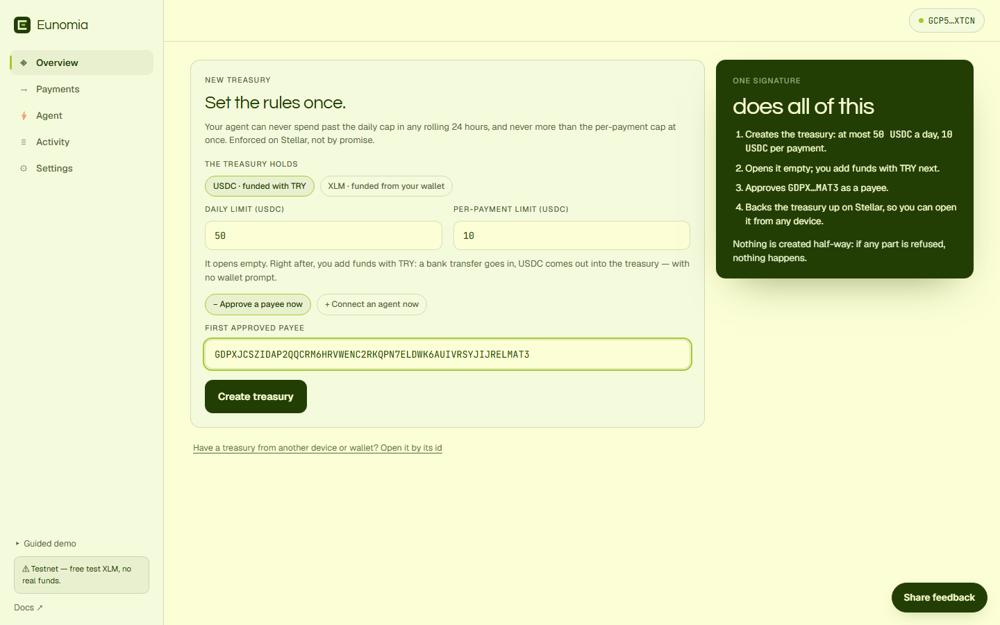
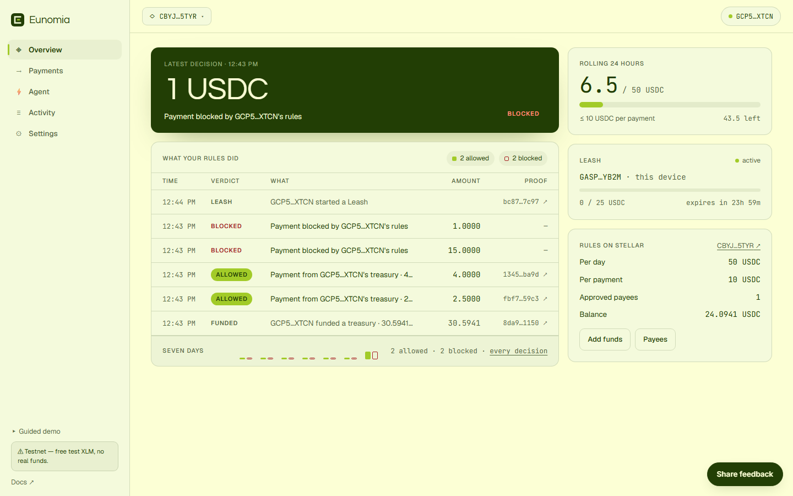
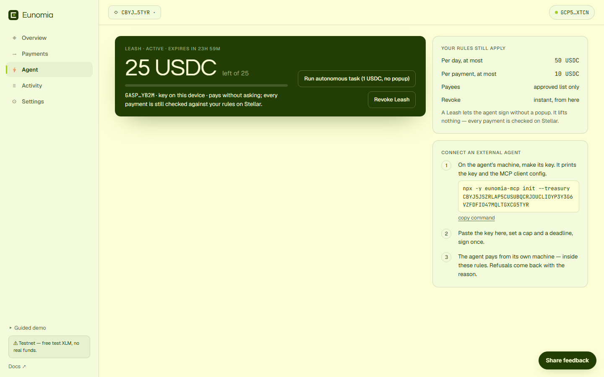

# Eunomia'yı Dene — 5 Dakikalık Rehber

*English version: [TRY-IT.md](TRY-IT.md)*

**Eunomia nedir?** Stellar üzerinde, bir yapay zekâ ajanına gerçek harcama yetkisini güvenle
vermeni sağlayan sınırlı bir kasa: günlük limit, ödeme başına limit ve onaylı alıcı listesi
**kontrat** tarafından uygulanır — model ne kadar "ikna edilirse" edilsin, para kuralların
dışına çıkamaz.

Eunomia **Stellar mainnet'te, beta olarak** çalışır: para gerçektir ve beta süresince her
kasanın bir yatırma üst sınırı vardır. Küçük tutarlarla başla. Sahip olarak yaptığın her
işlemi sen imzalarsın — emanetçi yok, para baştan sona senin kontrolünde.

**Uygulama:** [eunomia.finance](https://eunomia.finance)

## İki giriş yolu

**Passkey ile (en hızlısı).** Face ID, parmak izi ya da cihaz PIN'i. Cüzdan kurmak ya da
kurtarma kelimesi yazmak yok — passkey bir Stellar akıllı cüzdanını yönetir, işlem ücretleri
karşılanır. Telefonda da aynı şekilde çalışır.

**Cüzdan ile.** Zaten varsa: masaüstünde Freighter, xBull, Albedo, LOBSTR, Rabet ya da Hana;
telefonda WalletConnect destekleyen herhangi bir Stellar cüzdanı. Ücretler için biraz XLM'e
ve kasanın tutmasını istediğin USDC ya da XLM'e ihtiyacı var.

## Adımlar

1. **Giriş yap** — *Create your treasury with a passkey* → yüzün, parmak izin ya da PIN'inle
   onayla. (Cüzdan mı tercih ediyorsun? *I have a wallet* → kendininkini seç. Telefonda
   **WalletConnect**'i seçip QR'ı okut.)
2. **Kuralları koy ve oluştur — tek imza.** Kasa varsayılan olarak **USDC** tutar; istersen
   **XLM**'e çevirirsin. Günlük limiti ve ödeme başına limiti gir → *Create treasury* → bir
   kez onayla. İki isteğe bağlı seçenek aynı imzaya katlanır: *+ Approve a payee now* ve
   *+ Connect an agent now* (7. adım).

   

3. **Para ekle** — **Overview**'da *Add funds* → tutar → *Fund* → onayla. Para, kasanın kendi
   token'ıyla cüzdanından gelir; form imzalamadan önce cüzdanında ne kadar USDC olduğunu
   gösterir.
4. **Bir alıcıyı onayla** — **Payments**'ta ödeme yapılabilecek bir adres ekle. *(USDC kasada
   G… ile başlayan bir alıcının USDC alabilmesi için trustline'ı olmalı; passkey cüzdanına bir
   şey gerekmez.)*
5. **Ödeme gönder** — *Pay by hand* → onayladığın adres, limitler içinde bir tutar → zincire
   düşer ✓ ve kanıtıyla birlikte defterde görünür.
6. **Asıl gösteriyi izle** — ödeme başına limitin **üstünde** bir tutar ya da hiç onaylamadığın
   bir adrese ödeme dene: kontrat bunu **reddeder**, para yerinden oynamaz. O ret, ürünün
   çalıştığı andır. 🔴

   

7. **Ajana devret (artık onay penceresi yok)** — **Agent** sayfasının yazdığı komutu kopyala —
   `npx -y eunomia-mcp@0.3.5 init --treasury <kasa kimliğin> --client claude-code` — ve ajanın çalıştığı makinede çalıştır. Yazdırdığı açık
   anahtarı yapıştır, bir üst sınır ve süre gir, **Connect agent**: cüzdanın art arda birkaç
   imza ister (ajanın hesabı, alıcı onayları, Leash). Ajanın gizli anahtarı
   kendi makinesinden hiç çıkmaz. Komut sunucuyu MCP istemcine kendisi ekler; ondan
   sonra ajanın elinde `check_budget`, `pay`, `request_exception` ve diğerleri olur — retler
   ona kontratın kendi hata kodlarıyla döner. *Revoke Leash* kontrolü anında geri alır.

   

8. **Sahip kontrolleri** — **Settings**'te: *Pause spending* (ajanı dondurur; para çekme yine
   çalışır), *Withdraw* ile parayı bir adrese geri çek, *Update limits* ile limitleri canlı
   değiştir. Sahibin her zaman bir çıkışı vardır. Kasan Stellar üzerinde yedeklenir; aynı
   passkey ya da cüzdanla başka bir cihazdan girdiğinde kendiliğinden açılır.

## Bir şey ters giderse

- Hatalar uygulamanın içinde sade bir dille gösterilir (yetersiz bakiye, imza reddedildi vb.).
- Sağ alttaki **Share feedback** düğmesi kısa bir form açar — oraya yazacağın iki cümle yol
  haritasını doğrudan şekillendirir. 🙏

## Daha fazlası

- Ana [README](../README.md) — mimari ve kontratlar
- [`eunomia-mcp`](../packages/mcp/README.md) — ajanın eline geçen bütün araçlar
