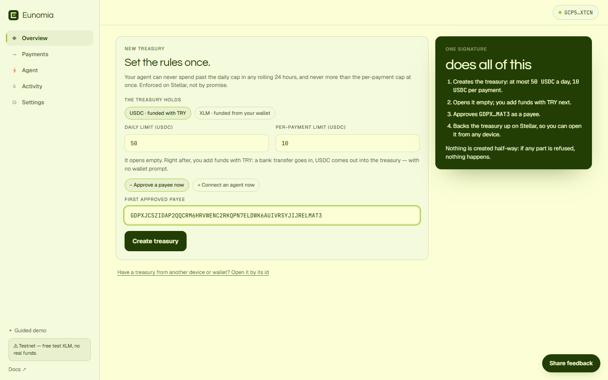
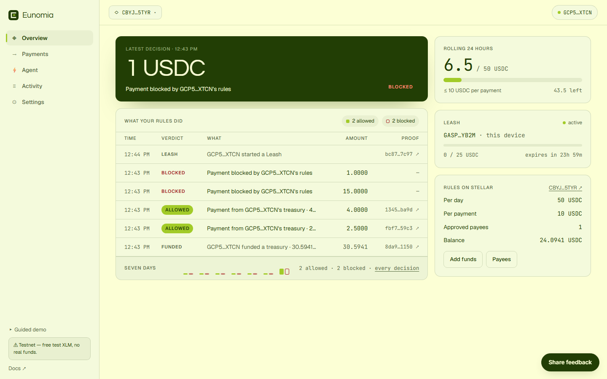
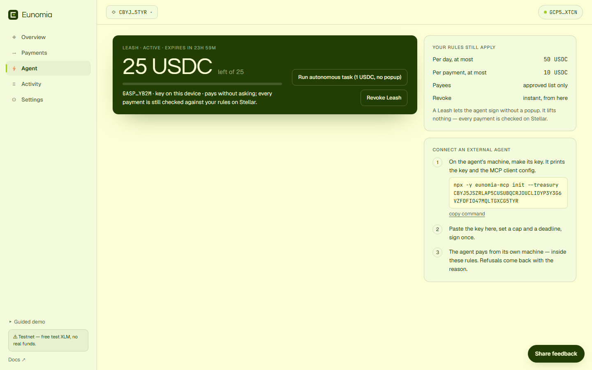

# Try Eunomia — a 5-Minute Guide

*Türkçe versiyon: [TRY-IT-TR.md](TRY-IT-TR.md)*

**What is Eunomia?** A bounded treasury on Stellar that lets you hand an AI agent real
spending power, safely: the daily limit, the per-payment limit and the list of approved
payees are enforced by the **contract** — no matter how hard the model is "persuaded", funds
can't leave the policy.

Eunomia runs on **Stellar mainnet, in beta**: real money, with a deposit cap on every
treasury while the beta lasts. Start small. Every owner action is signed by you —
non-custodial, funds stay under your control the whole time.

**App:** [eunomia.finance](https://eunomia.finance)

## Two ways in

**With a passkey (fastest).** Face ID, a fingerprint or your device PIN. No wallet to
install and no seed phrase to write down — the passkey controls a Stellar smart wallet and
transaction fees are sponsored. Works the same on a phone.

**With a wallet.** If you already have one: Freighter, xBull, Albedo, LOBSTR, Rabet or Hana
on desktop; any WalletConnect-capable Stellar wallet on a phone. It needs a little XLM for
fees, and the USDC or XLM you want the treasury to hold.

## Steps

1. **Sign in** — *Create your treasury with a passkey*, and confirm with your face,
   fingerprint or PIN. (Prefer a wallet? *I have a wallet* → pick yours. On a phone, choose
   **WalletConnect** and scan the QR.)
2. **Set the rules and create — one signature.** The treasury holds **USDC** unless you
   switch it to **XLM**. Enter a daily limit and a per-payment limit → *Create treasury* →
   confirm once. Two optional chips fold into that same signature: *+ Approve a payee now*
   and *+ Connect an agent now* (step 7).

   

3. **Add funds** — on **Overview**, *Add funds* → amount → *Fund* → confirm. The deposit comes
   from your wallet in the treasury's own token; the form shows how much USDC your wallet
   holds before you sign.
4. **Approve a payee** — on **Payments**, add an address that may be paid. *(In a USDC
   treasury a G… payee needs a USDC trustline to receive it; a passkey wallet needs nothing.)*
5. **Send a payment** — *Pay by hand* → your approved address, an amount within the limits →
   it lands on-chain ✓ and appears in the ledger with its proof.
6. **Now watch the real show** — try an amount **over** your per-payment limit, or a payment
   to an address you never approved: the contract **rejects it** and funds never move. That
   rejection is the product working. 🔴

   

7. **Hand it to an agent (no more popups)** — on **Agent**, copy the command the page prints —
   `npx -y eunomia-mcp@0.3.2 init --treasury <your id>` — and run it on the agent's machine. Paste the public key it prints, set a cap
   and a duration, **Authorise agent**. The agent's secret never leaves its machine. The
   command also prints the config to add to your MCP client; from then on the agent has
   `check_budget`, `pay`, `request_exception` and friends — and refusals come back to it with
   the contract's own error codes. *Revoke Leash* takes control back instantly.

   

8. **Owner controls** — in **Settings**: *Pause spending* (freezes the agent; withdraw still
   works), *Withdraw* funds back out to an address, and *Update limits* live. The owner always
   has an exit. Your treasury is backed up on Stellar, so it opens by itself when you sign in
   with the same passkey or wallet on another device.

## If something goes wrong

- Errors are shown in plain language inside the app (insufficient balance, signature
  rejected, and so on).
- The **Share feedback** button (bottom right) opens a short form — two sentences there
  directly shape the roadmap. 🙏

## More

- Main [README](../README.md) — architecture and contracts
- [`eunomia-mcp`](../packages/mcp/README.md) — every tool the agent gets
